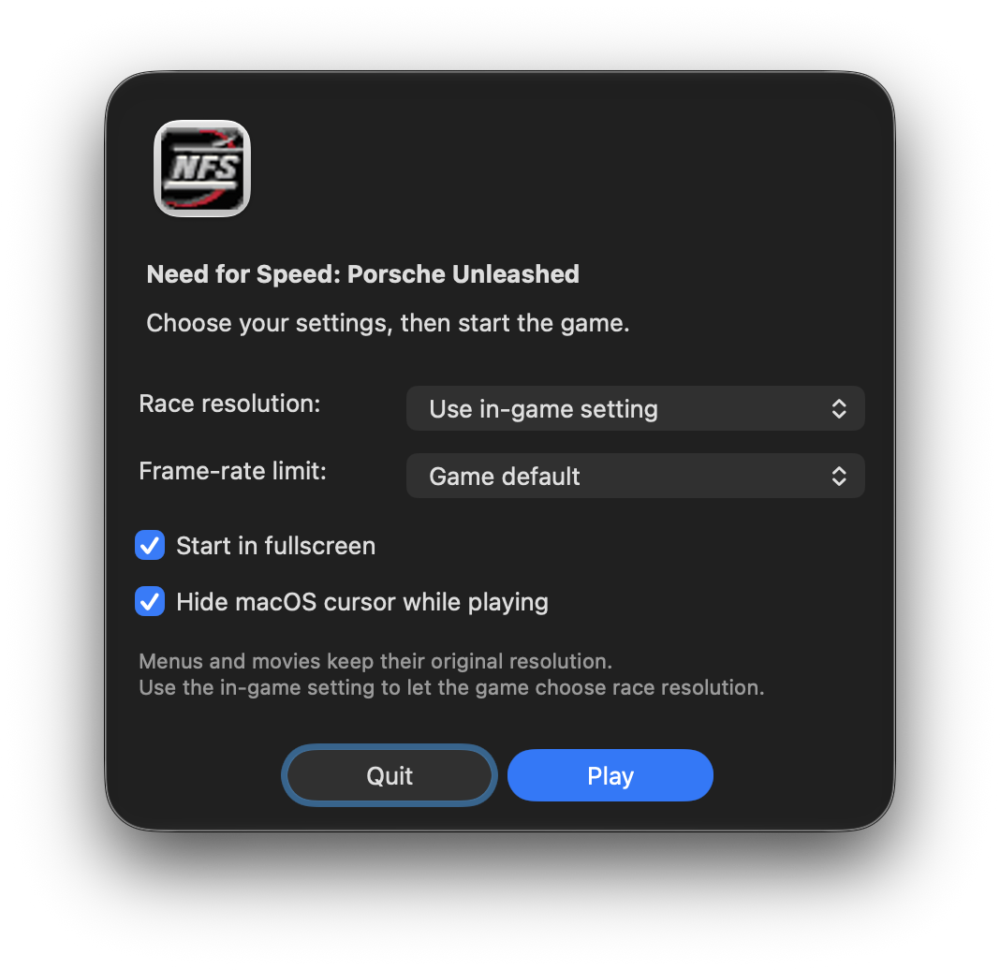
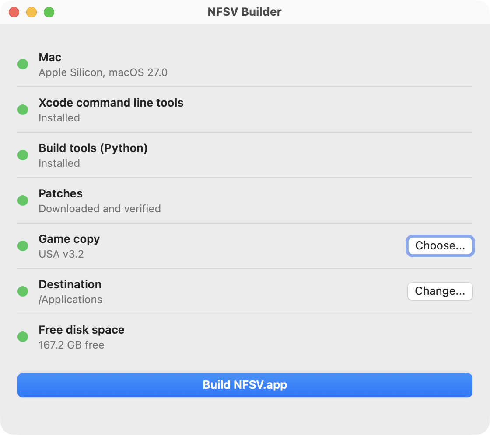

# NFSV for Apple Silicon

Play **Need for Speed: Porsche Unleashed** natively on your Apple Silicon Mac, built from your own game copy. NFSV turns your PC copy of the game into a Mac app with native ARM64 code, Metal graphics and CoreAudio sound.

<p align="center">
  
</p>

## What you get

- The original game: menus, garage, Quick Race, Evolution and Factory Driver.
- The original sound effects, music, movies and movie audio.
- Native Metal graphics in HD, 1440p and 4K race resolutions, in 16 and 32 bit color.
- Optional 4x antialiasing and 16x anisotropic filtering, on by default.
- A race HUD that scales with the resolution, including text, gauges, the map and the rear-view mirror.
- A launcher before each game: race resolution, fullscreen or windowed, frame-rate limit, HUD size, Mac cursor and enhanced graphics. Your choices are remembered.
- Fullscreen by default. Control-Command-F, F11 or the green window button switches between fullscreen and a window while you play.
- The original in-game pointer. The Mac cursor is hidden inside the game view by default and comes back outside the window.
- Keyboard and mouse controls, and Command-V or Control-V to paste text.
- Game controllers: PS4 (DualShock 4), PS5 (DualSense), Xbox, Switch Pro and other Mac-supported gamepads, over Bluetooth or USB. See [Game controllers](#game-controllers).
- Switching to another app releases held controls and keeps the picture and sound running without restarting the song.
- Your own saves, kept apart from the game files, which stay unchanged.

## What you need

- A Mac with Apple Silicon (M1 or later) and **macOS 12 or newer**. On macOS 11, use [Build from Terminal](#build-from-terminal) instead.
- Your own copy of the **English USA PC version** of the game, as a folder, a disc image (`.iso`) or a `.bin`/`.cue` pair. See [Which game copy works](#which-game-copy-works).
- An internet connection for the first build.

NFSV Builder installs everything else for you.

## Build your game

NFSV Builder is a small app that installs what is missing and builds NFSV.app from your own game copy.

<p align="center">
  
</p>

1. Download `NFSV-Builder.dmg` from the [Releases page](../../releases/latest) of this repository and open it. You do not need to copy NFSV Builder anywhere.
2. Run **NFSV Builder** from the opened disk.

NFSV Builder is free and open source but not signed by Apple, so macOS asks once before it opens. The same steps are drawn on the disk's background.

**On macOS 14 or older:** right-click **NFSV Builder** and choose **Open**.

**On macOS 15 or newer:**

1. macOS says it cannot be opened. Click **Done**.
2. Open **System Settings**, then **Privacy & Security**, and scroll down.
3. Click **Open Anyway**.

### The checklist

The Builder shows a checklist. Green rows are ready, orange rows are handled automatically, and red rows need you.

- **Mac**: Apple Silicon and a supported macOS version.
- **Xcode command line tools**: **Install...** opens Apple's installer (about 2 GB).
- **Build tools**: the Builder downloads its own private Python (about 90 MB) into `~/Library/Application Support/NFSV Builder`. It never touches other Python installs.
- **Patches**: downloaded during the build if they are not already cached.
- **Game copy**: click **Choose...** or drag a folder, `.iso`, `.bin` or `.cue` onto the window. If your copy is rejected, click **Which copy works?** to see the supported releases with their file counts, sizes and checksums.
- **Destination**: where NFSV.app is placed. The default is Applications.
- **Free disk space**: enough room for the build.

Fix the red rows, then click **Build NFSV.app**. When it finishes you can click **Play**, **Show in Finder** or **Remove build files**.

### Playing

Open NFSV.app. The launcher appears first:

- **Race resolution**: **Use in-game setting** lets the game's own graphics menu choose it. Menus and movies keep their original resolution.
- **Start in fullscreen**, or play in a window. Fullscreen is the initial default.
- **Frame-rate limit**: game default, 30, 60 or 120 FPS. This is a cap; the game and display can run slower.
- **HUD size**: try 75% for a smaller HUD in 4K; 100% keeps the full automatic size.
- **Hide macOS cursor while playing**: on by default.
- **Enhanced graphics**: smoother edges and sharper textures, on by default. Turn it off for the original look or a higher frame rate on older Macs.

Click **Play** to save your choices and start the game, or **Quit** to leave without saving edits. Choices are remembered for the next launch.

Saves and the game log live in `~/Library/Application Support/NFSV`. Rebuilding or replacing the app does not touch them, so existing careers keep their progress. Quit the game before rebuilding.

### Game controllers

Connect the controller to the Mac first, in **System Settings > Bluetooth** (or with a USB cable). It can be connected before or after starting the game.

In the game, open **options... > controllers > game controls**, set **default controller** to **Game Controller** and click **reset defaults**. The game's own defaults then fit the pad:

| Control | Pad (PlayStation / Xbox) | Shown in the game as |
| --- | --- | --- |
| Accelerate, brake | R2 / RT, L2 / LT (analog) | joystick 1 y axis up, down |
| Steer | Left stick | joystick 1 x axis |
| Hand brake | Cross / A | Button 1 |
| Look behind | Square / X | Button 3 |
| Reset car | Triangle / Y | Button 4 |
| Cameras | Share / View | Button 6 |
| Shift up, down | R1 / RB, L1 / LB | Button 8, Button 9 |

Any control can be rebound on the same screen: click it, then press a button or move a stick or trigger. The other buttons are Circle / B (Button 2), Options / Menu (Button 5), the left stick button (Button 7) and the right stick button (Button 10). The left stick's vertical movement is the z axis, the right stick is the x and y rotation axes, and the D-pad is the hat switch. The triggers share one axis, as Xbox pads do under DirectInput on Windows, so pressing both at once cancels out. The **deadzone** tab adjusts each axis. Force feedback and vibration are not supported.

The first connected controller is used. While another app is in front, the controller is ignored, like the keyboard.

## Which game copy works

You need the **English USA PC release of Need for Speed: Porsche Unleashed, version 3.2 or 3.4, unmodified**. It can be:

- a folder with the game files (`GameData`, `FEData`, `fe.txt`, `install.txt` and `Porsche.exe`),
- an ISO disc image, or
- a BIN/CUE disc image pair.

Localized (non-English) releases, console versions, incomplete folders and modified game files are rejected. You do not need to install any patches or find another `Porsche.exe` yourself: the build downloads and applies what it needs.

If your copy is rejected, the Builder's **Which copy works?** button lists the accepted releases. The exact file counts, sizes and checksums are in [Checksums and byte sizes](#checksums-and-byte-sizes) below.

---

# Technical details

The rest of this page is for power users, LLM agents and anyone curious about how the build works.

**This repository contains no EA game code, game executable, translated game functions or game assets. You must supply your own PC game copy.** The build script checks your files, downloads the required patches and translates the game locally. Downloaded patches, extracted files, generated code and finished apps are not tracked in git.

## Requirements in detail

- An Apple Silicon Mac. NFSV Builder needs macOS 12 or newer; the Terminal build and the game it produces support macOS 11 or newer.
- Xcode command line tools. NFSV Builder offers to install them; for the Terminal build, install them once with `xcode-select --install`. These are the only part that comes from Apple.
- Python: NFSV Builder installs its own. The Terminal build needs an ARM64 installation of Python 3.10 or newer, available as `python3`.
- Internet access for the first build's Python dependencies and patches.
- Your own supported English USA PC copy of the game, as a folder, ISO or BIN/CUE image.

Supported game data: **USA v3.2 or v3.4, unmodified**. A folder must contain `GameData`, `FEData`, `fe.txt`, `install.txt` and `Porsche.exe`. The original USA v3.2/v3.4 disc executables are accepted, as is the supported USA v3.5 executable over those same verified data files. Localized releases, console versions, incomplete folders and modified asset sets are rejected.

Compatibility is checked on the extracted files: both the game-data fingerprint and the separate `Porsche.exe` checksum must be accepted. The builder does not compare a checksum of the whole ISO, BIN or CUE file. See [checksums and byte sizes](#checksums-and-byte-sizes) below.

The script prepares the v3.5-based executable from Combined Patch v1.1 automatically. Do not install patches or find a replacement executable yourself.

## Build from Terminal

For power users and LLM agents. In Terminal, enter the repository folder:

```sh
cd /path/to/NFSV
```

Then run **one** of these commands:

```sh
./build.sh "/path/to/your/game-folder"
./build.sh "/path/to/your/game.iso"
./build.sh "/path/to/your/game.cue"
./build.sh "/path/to/your/game.bin"
```

For BIN/CUE, keep the BIN beside the CUE with the filename recorded in it. Use the CUE when available. The supported layout is one MODE1/2352 data track at `00:00:00`; audio and multi-track layouts are rejected. ISO images may contain 2048-byte logical sectors or raw MODE1/2352 sectors. Images with Joliet names preserve the game's long filenames.

The script sets up `.venv`, extracts images, verifies all game-data and executable checksums, downloads and verifies patches, translates the supported code, compiles it and signs the app locally. Your input copy and existing saves are never modified. Later builds reuse verified downloads and prepared files.

When it finishes, open **`out/NFSV.app`** in Finder. You can move the app to Applications; it contains a private copy of the prepared files and needs no separate game-folder selection. Keep generated apps and game files out of version control. Quit the game before rebuilding an existing app.

If a checksum fails, use a complete, unmodified supported copy. Renaming an unsupported executable or changing a version string will not make it compatible. `./build.sh --help` shows the accepted inputs.

## Launcher settings

The launcher offers race resolution, fullscreen/windowed mode, a frame-rate limit (game default, 30, 60 or 120 FPS), HUD size, macOS cursor visibility and enhanced graphics. Click **Play** to save your choices and start the game, or **Quit** to leave without saving edits. Choices are remembered for the next launch.

- **HUD size** ranges from 25% to 100% of the automatic resolution scaling, with the original HUD size as a minimum. Try 75% for a smaller HUD in 4K; 100% keeps the full automatic size.
- **Use in-game setting** lets the game's graphics menu control race resolution; choosing a specific launcher resolution overrides that setting for the session and selects 32-bit color when available. Menus and movies keep their original resolution.
- The frame-rate limit is a cap; the game and display can run slower.
- **Enhanced graphics** is on by default. It adds 4x multisample antialiasing and 16x anisotropic texture filtering, the driver settings that the Combined Patch readme asks Windows players to force in their graphics driver. Turn it off for the original look or a higher frame rate on older Macs.

The build extracts the original Windows game icon from your supplied `Porsche.exe` before patching and converts it to a macOS icon during packaging. No standalone game icon is included for packaging.

## Saves and build files

Saves and the game log live in `~/Library/Application Support/NFSV`. Rebuilding or replacing the app does not replace that directory. Existing careers keep their progress; fixes encoded in the patch's sample profile require a new profile.

The script keeps Python dependencies in `.venv`, extracted/prepared game files in `local/builds`, and generated C, objects and app output in `gen` and `out`. These paths are ignored by git. Patch archives stay outside the repository, in `~/Library/Caches/NFSV/patches`. Every cached download is checked before use. Upstream patch notices are retained with the prepared files and in the app.

NFSV Builder shares the patch cache `~/Library/Caches/NFSV/patches` with `./build.sh`. Its private Python and build files live in `~/Library/Application Support/NFSV Builder`. **Remove build files**, offered after a successful build, frees the space used while building; Python and the downloaded patches are kept.

## How native is it?

The build reads the verified 32-bit x86 executable from your locally prepared copy, discovers its functions and statically translates their instructions to C. Apple Clang then compiles that generated C to ARM64 machine code. The generated source contains code derived from your game copy; it exists only in ignored build directories and is never part of the repository.

The original game's logic, menus, physics, AI, modes and movie decoder run as compiled ARM64 functions. This is not an engine recreation. Windows imports are handled by native compatibility code for files, memory, threads and input. The original Thrash graphics interface is implemented with Metal, including textures, depth, fog and the patched primitive-drawing path; Cocoa provides windows and CoreAudio provides audio. The finished app does not use Wine, Rosetta or a runtime x86 interpreter.

When a launcher resolution is selected, a native callback updates the original front-end resolution accessor before its original getter runs. The game then selects its video mode through its normal path. This changes runtime settings; the supplied executable and bundled game assets remain unchanged. The optional native frame cap releases the guest lock while waiting so audio and other guest threads can continue.

It still preserves the original 32-bit address space, x86 register/flag state, x87/SSE semantics and indirect-call dispatch in its generated code. That adds overhead compared with a port written from the original C/C++ source. ARM64 uses 64-bit floating-point intermediates where x86 could use 80-bit x87 values, so exact numerical equivalence is not guaranteed in every path.

Before translation, Unicorn runs only the verified patch's initialization at build time to resolve its instruction changes. Unicorn and Python are not bundled in the app. The resulting patched `Porsche.exe` is verified against the prepared-executable SHA-256 documented below.

## Patches used

| Patch | Version and source | Use in this port |
| --- | --- | --- |
| NFS Porsche Unleashed Combined Patch | **v1.1** by Tsalikon / A Future Pilot. [Original announcement](https://www.nfsaddons.com/forums/index.php?topic=2032.0); the author's download is unavailable. The script uses a [pinned community mirror](https://github.com/legluondunet/MyLittleLutrisScripts/tree/2544370ac45b736a6ba8dc0dbb26e31c4c7f23b2/Need%20for%20Speed%20-%20Porsche%20Unleashed), verified by SHA-256. | v3.5-based game and Verok patch code, NFS5 Essentials fixes, four official extra cars, database/model/HUD fixes and Smooth Shines and Lights. |
| SilentPatchNFS90s | **Build 1**, from the [author's release](https://github.com/CookiePLMonster/SilentPatchNFS90s/releases/tag/BUILD-1). | Applicable NFS Porsche behavior is implemented in the native input, threading and graphics services. The Windows ASI and proxy DLL do not run. |

The mirror's 147 original archive members match the supported Combined Patch; its extra log file is not installed. These checksums cover the complete downloaded ZIP files, before extraction:

| Patch archive filename | Exact size (bytes) | SHA-256 of ZIP file |
| --- | ---: | --- |
| `NFS5-Combined-Patch-v1.1.zip` (mirror) | 14026990 | `cc3087b5f8914dd47ab4e2b54da2e68c4caa03ab4871c11183a4720eba193d66` |
| `SilentPatchNFS90s.zip` (Build 1) | 1122658 | `6c3b181301f3b6e646f4f42ad8e89f74dd3fea95cc028d055c56ddab7e0fd1b8` |

Windows DirectX/Glide/OpenGL wrappers and the Windows configurator are replaced by native services. Preparation selects English, movies, fog and filtering enabled, automatic CPU calculation and the patch's default car-control setting. The older Enhanced Patch document bundled with Combined Patch describes additional gameplay enhancements that this package does not include. Combined Patch v1.0 is not used: v1.1 contains all of its game data, and its executable and nGlide setup are Windows-only. See [patch coverage](docs/patches.md), which also lists other patches that were reviewed.

## Checksums and byte sizes

The builder verifies the following extracted game data and source executable independently. All sizes below are exact decimal byte counts. No table below lists a whole-disc image checksum or image size; different image containers can hold the same accepted files.

The **game-data fingerprint** covers every file under `GameData` and `FEData`, plus `fe.txt` and `install.txt`. It excludes `Porsche.exe`, saves and OS/source-control metadata. The builder hashes a sorted list of case-insensitive relative paths and each file's SHA-256. This aggregate is not the result of running `shasum` on one file or concatenating the game files. The size column is the sum of the included files' contents, excluding filesystem overhead.

| Extracted data version | Included files | Total data size (bytes) | Aggregate game-data SHA-256 |
| --- | ---: | ---: | --- |
| USA v3.2 | 1568 | 528771197 | `e5b118ac8e7910049f7fc9bde3274b44f7eb5911e30efece7e3b33d68ea20747` |
| USA v3.4 | 1567 | 528742714 | `57f3f4d1405e7b41b2581c47558ef4aa8b31e3d8c29fb1038334a0d34a30a1b8` |

The **source executable checksum** covers only the bytes of `Porsche.exe` in the input game folder, before patching. One of these executable identities must accompany one of the accepted data sets above:

| Source executable version | Exact filename | Exact size (bytes) | SHA-256 of executable file |
| --- | --- | ---: | --- |
| USA v3.2 disc loader | `Porsche.exe` | 249119 | `6c862baecb74ad15be61fe54dd4ee0e4401719d369c74432dbfe9381c1812f11` |
| USA v3.4 disc loader | `Porsche.exe` | 341279 | `4b7bc7fc134f3e6145b9ad5dea1938085e9562344a088279d216f08a1543e9d8` |
| Supported USA v3.5 executable | `Porsche.exe` | 2129965 | `02437ddbf41af86dffe14251b28ed8889bd1c4c904fe77ff730d8912257ec90d` |

To check an extracted executable manually on macOS:

```sh
shasum -a 256 "/path/to/your/game-folder/Porsche.exe"
stat -f '%z' "/path/to/your/game-folder/Porsche.exe"
```

The builder creates a different `Porsche.exe` in its private prepared folder by linking the required patch code. This **build output** is checked before translation; it is not an executable you need to supply:

| Prepared executable | Exact filename | Exact size (bytes) | SHA-256 of executable file |
| --- | --- | ---: | --- |
| Combined Patch v1.1, linked for native translation | `Porsche.exe` | 2924032 | `13273410b8951e3785a5def780667d6101b1f72e8ac8fd9561f13b3cf724267b` |

## Limitations

Menus and movies retain their source artwork and aspect ratio. Higher race resolutions do not add detail to that artwork. Menus, driving, sound and intro playback have been exercised; complete career progression, every patched car/track and long sessions still need play testing. Internet multiplayer is not established by this port, and game controllers have no force feedback.

## Legal and notices

Everything derived from your game copy is generated locally on your Mac and is never part of this repository.

Compiler/runtime support code has its own third-party notices and restrictions in [third_party](third_party). Building a private app does not add permission to redistribute the game's code or assets.
